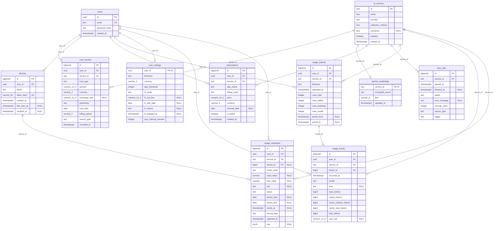

# DB ERD

AI Usage Hub의 데이터베이스 구조입니다. 운영 DB는 Railway PostgreSQL이며, 테스트는 SQLite에서 같은 모델로 실행합니다.

## 관리 방법

이 문서의 **ERD와 테이블 명세는 `backend/app/models.py`에서 자동 생성**됩니다. 손으로 고치지 않습니다.

스키마를 바꿀 때는 다음 순서를 따릅니다.

1. `backend/app/models.py`를 수정합니다.
2. 마이그레이션을 만듭니다: `uv run alembic revision --autogenerate -m "<변경 내용>"` 후 생성된 파일을 검토합니다.
3. 적용과 일치 여부를 확인합니다: `uv run alembic upgrade head` → `uv run alembic check`
4. ERD를 다시 생성합니다: `uv run python -m app.erd`
5. 아래 "마이그레이션 이력" 표에 한 줄 추가합니다.

모든 명령은 `backend` 폴더에서 실행합니다. `uv run pytest`는 이 문서가 모델과 다르면 실패하므로, 4단계를 빠뜨리면 테스트에서 걸립니다.

## 테이블 역할

| 테이블 | 역할 | 비고 |
|---|---|---|
| `users` | 로그인 계정 | 현재는 관리자 1명. 다중 사용자 확장을 위해 다른 테이블이 `user_id`로 참조 |
| `user_settings` | 사용자별 설정 | 표시 통화, 시간대, 알림 임계치, 수집 주기, 적용 환율(자동/직접 입력) |
| `ai_services` | 서비스 목록 | `collection_method`는 화면의 API/CLI/수동 뱃지. `connector`가 있어야 자동 수집 대상 |
| `service_credentials` | 서비스 API 키 | Fernet으로 암호화해 저장. 화면에는 끝 4자리만 노출 |
| `subscriptions` | 구독 요금제 | 월 구독료 합계와 갱신 D-day의 원천. API 비용과 섞지 않음 |
| `usage_snapshots` | 시점별 사용량 | 수동 입력·API 커넥터 값은 `device_id`가 NULL이며 대시보드는 그중 최신 1건을 표시. 기기 에이전트 값은 `device_id`가 있고 (기기, 서비스, 지표, 기간 시작) 단위로 덮어쓰며, 대시보드는 기기별 이번 달 누계(`tokens_month`)를 합산 |
| `cost_records` | API 종량제 비용 | 일 단위(API) 또는 월 단위(수동). 같은 버킷은 덮어씀(upsert) |
| `sync_jobs` | 수집 이력 | 성공/실패, 오류 메시지(API 키 마스킹), 수동/자동 실행 구분 |
| `usage_imports` | CSV 업로드 이력 | 파일 이름, 전체·추가·중복·오류 행 수, 파일의 기간. 삭제하면 이 업로드로 새로 추가된 요청만 함께 삭제 |
| `usage_events` | 요청 1건의 토큰 사용량 (CSV 업로드) | 시각은 UTC. (사용자, 서비스, 시각, 모델, 총 토큰)이 같으면 같은 요청으로 보고 한 번만 저장 → 기간이 겹치는 파일을 다시 올려도 이중 집계되지 않음 |
| `devices` | 사용량 에이전트를 실행하는 기기(PC) | 기기 토큰은 SHA-256 해시만 저장. `last_seen_at`으로 온라인 여부, `revoked_at`으로 폐기 표시 |

## 데이터 규칙

- **값이 없으면 0이 아니라 NULL**: `usage_snapshots.used_value`가 NULL이고 `status='unavailable'`이면 "수집 불가"로 표시합니다.
- **구독료와 API 비용 분리**: 구독료는 `subscriptions`에서만 계산하고, `cost_records`에는 API 비용만 둡니다.
- **원 통화 보존**: 금액은 원래 통화로 저장하고, 화면에서 `user_settings`의 환율로 환산합니다. `cost_records.exchange_rate`가 있으면 그 값이 우선합니다.
- **토큰 출처 합산**: 서비스의 이번 달 토큰 = 기기별 `tokens_month` 합계 + 이번 달(현지 시간) `usage_events` 합계. CSV 값은 요청 단위로 저장하므로 월 단위로 다시 계산합니다.
- **기기 값 합산**: 같은 서비스의 기기 값은 기기마다 이번 달 누계 1행만 유지하므로 그대로 더하면 됩니다. 폐기한 기기의 값도 실제 사용분이라 합계에 남습니다.
- **출처 기록**: `usage_snapshots`, `cost_records`, `sync_jobs`의 `source_type`(api/cli/manual)으로 데이터가 어디서 왔는지 구분합니다.
- **평문 비밀 금지**: 비밀번호는 scrypt 해시, 서비스 API 키는 Fernet 암호문으로만 저장합니다.

## 마이그레이션 이력

| 리비전 | 파일 | 내용 |
|---|---|---|
| 0001 | `backend/migrations/versions/0001_initial_schema.py` | 초기 스키마 8개 테이블 |
| 0002 | `backend/migrations/versions/0002_fx_auto.py` | `user_settings`에 `fx_mode`, `fx_source`, `fx_updated_at` 추가. 기존 직접 입력 환율은 manual 모드로 보존 |
| 0003 | `backend/migrations/versions/0003_devices.py` | `devices` 테이블 추가, `usage_snapshots.device_id`와 기기별 덮어쓰기용 유니크 제약 추가 |
| 0004 | `backend/migrations/versions/0004_usage_imports.py` | `usage_imports`, `usage_events` 테이블 추가 (Cursor CSV 업로드) |

## ERD와 테이블 명세

<!-- ERD:BEGIN — app/models.py 에서 자동 생성. 직접 수정하지 말고 `uv run python -m app.erd` 실행 -->

테이블 11개. 타입은 PostgreSQL 기준입니다.

### `ai_services`

| 컬럼 | 타입 | NULL | 기본값 | 키 |
|---|---|---|---|---|
| `id` | text |  |  | PK |
| `name` | text |  |  |  |
| `provider` | text |  |  |  |
| `collection_method` | text |  | `'manual'` |  |
| `connector` | text | Y |  |  |
| `enabled` | boolean |  | `true` |  |
| `created_at` | timestamptz |  | `now()` |  |

- CHECK `ck_ai_services_method`: `collection_method IN ('api', 'cli', 'manual')`

### `users`

| 컬럼 | 타입 | NULL | 기본값 | 키 |
|---|---|---|---|---|
| `id` | uuid |  | `uuid4()` | PK |
| `email` | text |  |  | UK |
| `password_hash` | text |  |  |  |
| `created_at` | timestamptz |  | `now()` |  |

### `cost_records`

| 컬럼 | 타입 | NULL | 기본값 | 키 |
|---|---|---|---|---|
| `id` | bigserial |  |  | PK |
| `user_id` | uuid |  |  | FK → `users.id` |
| `service_id` | text |  |  | FK → `ai_services.id` |
| `cost_type` | text |  | `'api_usage'` |  |
| `amount` | numeric_12_4 |  |  |  |
| `currency` | varchar_3 |  |  |  |
| `exchange_rate` | numeric_10_4 | Y |  |  |
| `granularity` | text |  | `'day'` |  |
| `cost_date` | date |  |  |  |
| `billing_period` | varchar_7 |  |  |  |
| `source_type` | text |  |  |  |
| `recorded_at` | timestamptz |  | `now()` |  |

- CHECK `ck_cost_records_granularity`: `granularity IN ('day', 'month')`
- CHECK `ck_cost_records_type`: `cost_type IN ('api_usage', 'other')`
- UNIQUE `uq_cost_records_bucket`: (user_id, service_id, cost_type, source_type, granularity, cost_date)
- INDEX `ix_cost_records_period`: (billing_period)

### `devices`

| 컬럼 | 타입 | NULL | 기본값 | 키 |
|---|---|---|---|---|
| `id` | bigserial |  |  | PK |
| `user_id` | uuid |  |  | FK → `users.id` |
| `name` | text |  |  |  |
| `token_hash` | varchar_64 |  |  | UK |
| `created_at` | timestamptz |  | `now()` |  |
| `last_seen_at` | timestamptz | Y |  |  |
| `revoked_at` | timestamptz | Y |  |  |

- UNIQUE `uq_devices_user_name`: (user_id, name)

### `service_credentials`

| 컬럼 | 타입 | NULL | 기본값 | 키 |
|---|---|---|---|---|
| `service_id` | text |  |  | PK, FK → `ai_services.id (ON DELETE CASCADE)` |
| `encrypted_secret` | text |  |  |  |
| `hint` | varchar_8 |  |  |  |
| `updated_at` | timestamptz |  | `now()` |  |

### `subscriptions`

| 컬럼 | 타입 | NULL | 기본값 | 키 |
|---|---|---|---|---|
| `id` | bigserial |  |  | PK |
| `user_id` | uuid |  |  | FK → `users.id` |
| `service_id` | text |  |  | FK → `ai_services.id` |
| `plan_name` | text |  |  |  |
| `billing_cycle` | text |  | `'monthly'` |  |
| `price` | numeric_10_2 |  |  |  |
| `currency` | varchar_3 |  |  |  |
| `renewal_date` | date | Y |  |  |
| `is_active` | boolean |  | `true` |  |
| `created_at` | timestamptz |  | `now()` |  |

- CHECK `ck_subscriptions_cycle`: `billing_cycle IN ('monthly', 'annual')`

### `sync_jobs`

| 컬럼 | 타입 | NULL | 기본값 | 키 |
|---|---|---|---|---|
| `id` | bigserial |  |  | PK |
| `service_id` | text |  |  | FK → `ai_services.id` |
| `started_at` | timestamptz |  |  |  |
| `finished_at` | timestamptz | Y |  |  |
| `status` | text |  |  |  |
| `error_message` | text | Y |  |  |
| `records_count` | integer |  | `0` |  |
| `source_type` | text |  |  |  |
| `trigger` | text |  | `'manual'` |  |

- CHECK `ck_sync_jobs_status`: `status IN ('running', 'success', 'failed', 'partial')`
- INDEX `ix_sync_jobs_service_started`: (service_id, started_at)

### `usage_imports`

| 컬럼 | 타입 | NULL | 기본값 | 키 |
|---|---|---|---|---|
| `id` | bigserial |  |  | PK |
| `user_id` | uuid |  |  | FK → `users.id` |
| `service_id` | text |  |  | FK → `ai_services.id` |
| `filename` | text |  |  |  |
| `uploaded_at` | timestamptz |  | `now()` |  |
| `rows_total` | integer |  | `0` |  |
| `rows_added` | integer |  | `0` |  |
| `rows_duplicate` | integer |  | `0` |  |
| `rows_invalid` | integer |  | `0` |  |
| `period_from` | timestamptz | Y |  |  |
| `period_to` | timestamptz | Y |  |  |

### `user_settings`

| 컬럼 | 타입 | NULL | 기본값 | 키 |
|---|---|---|---|---|
| `user_id` | uuid |  |  | PK, FK → `users.id` |
| `timezone` | text |  | `'Asia/Seoul'` |  |
| `currency` | varchar_3 |  | `'KRW'` |  |
| `alert_threshold` | integer |  | `80` |  |
| `fx_mode` | text |  | `'auto'` |  |
| `fx_usd_krw` | numeric_10_4 | Y |  |  |
| `fx_rate_date` | date | Y |  |  |
| `fx_source` | text | Y |  |  |
| `fx_updated_at` | timestamptz | Y |  |  |
| `sync_interval_minutes` | integer |  | `60` |  |

- CHECK `ck_user_settings_fx_mode`: `fx_mode IN ('auto', 'manual')`

### `usage_events`

| 컬럼 | 타입 | NULL | 기본값 | 키 |
|---|---|---|---|---|
| `id` | bigserial |  |  | PK |
| `user_id` | uuid |  |  | FK → `users.id` |
| `service_id` | text |  |  | FK → `ai_services.id` |
| `import_id` | bigint |  |  | FK → `usage_imports.id (ON DELETE CASCADE)` |
| `occurred_at` | timestamptz |  |  |  |
| `model` | text |  |  |  |
| `kind` | text | Y |  |  |
| `input_tokens` | bigint |  |  |  |
| `output_tokens` | bigint |  |  |  |
| `cache_creation_tokens` | bigint |  |  |  |
| `cache_read_tokens` | bigint |  |  |  |
| `total_tokens` | bigint |  |  |  |
| `cost_usd` | numeric_12_6 | Y |  |  |

- UNIQUE `uq_usage_events_identity`: (user_id, service_id, occurred_at, model, total_tokens)
- INDEX `ix_usage_events_service_time`: (service_id, occurred_at)

### `usage_snapshots`

| 컬럼 | 타입 | NULL | 기본값 | 키 |
|---|---|---|---|---|
| `id` | bigserial |  |  | PK |
| `user_id` | uuid |  |  | FK → `users.id` |
| `service_id` | text |  |  | FK → `ai_services.id` |
| `device_id` | bigint | Y |  | FK → `devices.id` |
| `metric_code` | text |  |  |  |
| `used_value` | numeric | Y |  |  |
| `limit_value` | numeric | Y |  |  |
| `unit` | text | Y |  |  |
| `status` | text |  | `'ok'` |  |
| `period_start` | date | Y |  |  |
| `period_end` | date | Y |  |  |
| `resets_at` | timestamptz | Y |  |  |
| `source_type` | text |  |  |  |
| `captured_at` | timestamptz |  | `now()` |  |
| `raw` | jsonb | Y |  |  |

- CHECK `ck_usage_snapshots_source`: `source_type IN ('api', 'cli', 'manual')`
- CHECK `ck_usage_snapshots_status`: `status IN ('ok', 'unavailable')`
- UNIQUE `uq_usage_snapshots_device_bucket`: (device_id, service_id, metric_code, period_start)
- INDEX `ix_usage_snapshots_service_captured`: (service_id, captured_at)

<!-- ERD:END -->
